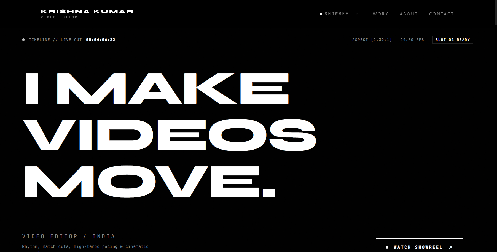

# Krishna Kumar — Video Editor Portfolio

A sleek, cinematic portfolio website built for **Krishna Kumar**, showcasing video editing, commercial spec cuts, rhythm pacing, and sound design. Engineered with React 19, Vite, Tailwind CSS v4, and Framer Motion.



---

## 🌟 Overview

This portfolio website highlights the craft of video editing with a bold, dark aesthetic inspired by modern cinema and high-fashion editorial layouts. Designed to give directors, producers, and clients an immersive visual experience with custom video player controls, smooth micro-interactions, ambient lighting, and project breakdowns.

---

## ✨ Key Features

- **Cinematic Showreel Modal**: Custom-built video player overlay with timecode display, resolution badge (`4K PRORES`), playback controls, and keyboard navigation (`Space` to play/pause, `M` to mute/unmute, `Esc` to close).
- **Curated Projects Showcase**: Interactive project cards detailing categories, deliverables (Offline Edit, Color Grade, Sound Mix), aspect ratios, and spec status.
- **Ambient Lighting & Grain Effects**: Interactive cursor-following ambient glow and subtle analog noise overlay for a tactile cinematic feel.
- **Dynamic Marquee**: Continuous ticker animating editorial keywords and craft disciplines.
- **Scroll Progress & Fluid Navigation**: Responsive top progress indicator and fixed navigation bar with smooth anchor scrolling and mobile menu drawer.
- **Single Source of Truth**: Centralized configuration in `src/data/portfolioData.js` for easily updating editorial projects, showreel details, and biography.

---

## 🛠️ Tech Stack

- **Framework**: [React 19](https://react.dev/)
- **Build Tool**: [Vite 8](https://vitejs.dev/)
- **Styling**: [Tailwind CSS v4](https://tailwindcss.com/)
- **Animations**: [Framer Motion](https://www.framer.com/motion/)
- **Icons**: [Lucide React](https://lucide.dev/)
- **Linting & Code Quality**: [Oxlint](https://oxc.rs/)
- **Typography**: [Geist & Geist Mono](https://vercel.com/font), [Inter](https://fonts.google.com/specimen/Inter)

---

## 📁 Project Structure

```text
Porfolio_Website-K^3/
├── public/                 # Static assets, preview graphics, and favicons
│   ├── favicon.svg
│   ├── portfolio_preview.png
│   └── contact_preview.png
├── src/
│   ├── assets/             # Component-level static media
│   ├── components/         # Modular UI components
│   │   ├── AboutSection.jsx    # Editorial philosophy and capabilities
│   │   ├── AmbientGlow.jsx     # Pointer-following ambient light
│   │   ├── ContactSection.jsx  # Inquiries and social channels
│   │   ├── FocusSection.jsx    # Current projects and status
│   │   ├── Footer.jsx          # Site footer and copyright
│   │   ├── Hero.jsx            # Headline, typewriter roles, and showreel CTA
│   │   ├── Marquee.jsx         # Infinite text ticker
│   │   ├── Navbar.jsx          # Fixed header with navigation links
│   │   ├── ProjectCard.jsx     # Interactive project display card
│   │   ├── ScrollProgress.jsx  # Top scrollbar indicator
│   │   ├── VideoModal.jsx      # Cinematic full-screen video player
│   │   └── WorkSection.jsx     # Selected projects grid
│   ├── data/
│   │   └── portfolioData.js    # Editor bio, showreel specs, and project metadata
│   ├── App.css
│   ├── App.jsx                 # Main layout tree and modal state
│   ├── index.css               # Design system tokens and custom utilities
│   └── main.jsx                # Application root entry point
├── .gitignore              # Git ignore rules for node_modules, build artifacts, envs
├── .oxlintrc.json          # Oxlint configuration
├── index.html              # HTML shell with meta tags and Google Fonts
├── package.json            # Project dependencies and npm scripts
└── vite.config.js          # Vite and Tailwind plugin configuration
```

---

## 🚀 Getting Started

### Prerequisites

Ensure you have [Node.js](https://nodejs.org/) installed on your machine (version 18 or newer recommended).

### Installation

1. **Clone the repository**:
   ```bash
   git clone https://github.com/kkrishk2008-netizen/Porfolio_Website-K-3.git
   cd Porfolio_Website-K-3
   ```

2. **Install dependencies**:
   ```bash
   npm install
   ```

### Running Locally

Start the Vite development server:

```bash
npm run dev
```

Open [http://localhost:5173](http://localhost:5173) in your browser to view the portfolio.

---

## 📜 Available Scripts

| Command | Description |
| :--- | :--- |
| `npm run dev` | Starts the local development server with Hot Module Replacement (HMR). |
| `npm run build` | Compiles and bundles production-ready assets to the `dist/` directory. |
| `npm run preview` | Runs a local server to preview the production build. |
| `npm run lint` | Runs [Oxlint](https://oxc.rs/) to check code quality and lint rules. |

---

## 🌐 Deployment

This project builds to static files in `dist/` and can be easily hosted on any static hosting platform:

- **Vercel**: Connect the repository, set build command to `npm run build` and output directory to `dist`.
- **Netlify**: Set build command to `npm run build` and publish directory to `dist`.
- **GitHub Pages**: Deploy the `dist/` folder using the GitHub Actions static pages workflow.

---

## 📬 Contact & Links

- **Editor**: Krishna Kumar
- **Email**: [kkrishk2008@gmail.com](mailto:kkrishk2008@gmail.com)
- **GitHub**: [@kkrishk2008-netizen](https://github.com/kkrishk2008-netizen)

